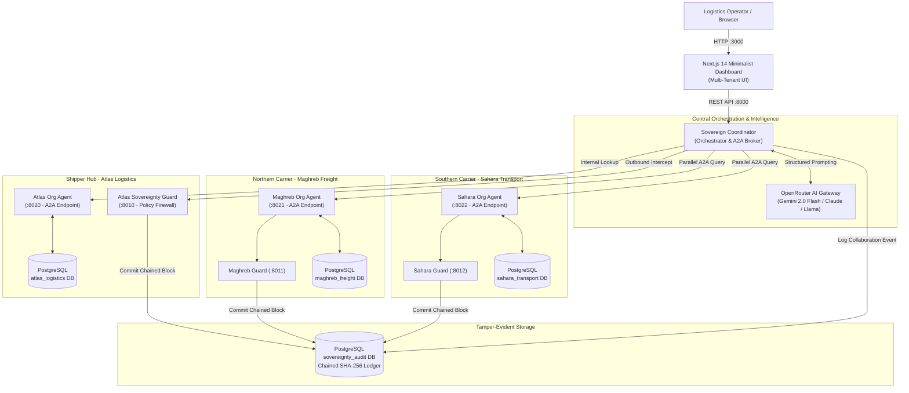
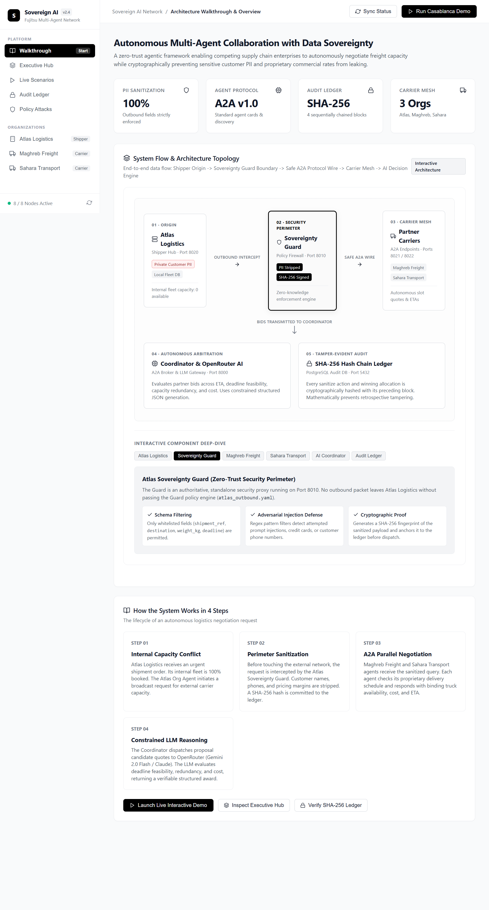

# Sovereign Logistics AI Agents


> Decentralized Agent-to-Agent (A2A) logistics collaboration with zero-knowledge data sovereignty enforcement,  LLM API reasoning, and cryptographically chained SHA-256 audit trails.

[](https://fastapi.tiangolo.com)
[](https://nextjs.org)
[](https://www.postgresql.org)
[](https://www.docker.com)
[](https://openrouter.ai)
[](LICENSE)

---

## Table of Contents

- [1. Executive Summary](#1-executive-summary)
- [2. The Challenge vs. The Sovereign Solution](#2-the-challenge-vs-the-sovereign-solution)
- [3. System Architecture & Topology](#3-system-architecture--topology)
- [4. End-to-End Walkthrough](#4-end-to-end-walkthrough)
- [5. Walkthrough Interface](#5-walkthrough-interface)
- [6. Security & Policy Enforcement (Sovereignty Guard)](#6-security--policy-enforcement-sovereignty-guard)
- [7. Cryptographic SHA-256 Audit Ledger](#7-cryptographic-sha-256-audit-ledger)
- [8. Repository Structure](#8-repository-structure)
- [9. Quick Start (Docker Compose)](#9-quick-start-docker-compose)
- [10. Scenario Execution & Adversarial Testing](#10-scenario-execution--adversarial-testing)
- [11. Production & Cloud Deployment (AWS EC2)](#11-production--cloud-deployment-aws-ec2)
- [12. Disclaimer & License](#12-disclaimer--license)

---

## 1. Executive Summary

Modern logistics and supply-chain operations require real-time collaboration between independent corporate entities (shippers, freight forwarders, regional carriers). When a shipper faces capacity deficits or equipment bottlenecks, finding external partner capacity traditionally requires manual broker calls or exposing internal database records.

Direct integration of autonomous AI agents across corporate perimeters introduces critical security vulnerabilities:
- **Customer PII Exposure**: Leaking sensitive customer names, addresses, and contact numbers.
- **Commercial Secrets**: Revealing proprietary profit margins, customer contract rates, or fleet dispatch schedules to competitor carriers.
- **Prompt Injection & Adversarial Exploits**: Malicious inputs manipulating agent orchestration logic.

The **Sovereign AI Multi-Agent Network** establishes a zero-trust architecture where autonomous enterprise agents collaborate via standardized **Agent-to-Agent (A2A)** protocols behind authoritative, policy-enforced **Sovereignty Guards**. Sensitive customer data is mathematically prevented from leaving the enterprise boundary, while every cross-organizational interaction is immutably anchored to a **chained SHA-256 cryptographic ledger**.

---

## 2. The Challenge vs. The Sovereign Solution

| Dimension | Conventional Inter-Agent Collaboration | Sovereign AI Architecture |
| :--- | :--- | :--- |
| **Data Boundary** | Raw shipment records shared across APIs | Strict perimeter policy proxy (Sovereignty Guard) |
| **Customer Privacy** | Customer names and phones exposed to carriers | 100% PII redaction; only cargo specs cross the perimeter |
| **Partner Discovery** | Hardcoded, proprietary API integrations | Standardized A2A Agent Cards (`/.well-known/agent.json`) |
| **Arbitration** | Manual negotiation or opaque black-box LLMs | Constrained LLM reasoning with structured JSON schemas |
| **Auditability** | Vulnerable database logs subject to tampering | Cryptographically chained SHA-256 Merkle block ledger |
| **Fault Tolerance** | Service halts if external AI APIs rate-limit | Transparent fallback to deterministic scoring formulas |

---

## 3. System Architecture & Topology

The platform deploys as an isolated multi-service mesh comprising 9 microservices and 4 isolated PostgreSQL databases running inside a secure Docker network.



### Microservice Matrix

| Service | Container Name | Port | Base Image | Role |
| :--- | :--- | :--- | :--- | :--- |
| **Coordinator** | `coordinator` | `8000` | Python 3.11 / FastAPI | Discovers partner agents, executes guarded A2A queries, and prompts OpenRouter LLM |
| **Atlas Guard** | `guard-atlas` | `8010` | Python 3.11 / FastAPI | Policy firewall intercepting and sanitizing Atlas outbound queries |
| **Maghreb Guard** | `guard-maghreb` | `8011` | Python 3.11 / FastAPI | Policy firewall enforcing Maghreb data governance |
| **Sahara Guard** | `guard-sahara` | `8012` | Python 3.11 / FastAPI | Policy firewall enforcing Sahara data governance |
| **Atlas Agent** | `agent-atlas` | `8020` | Python 3.11 / FastAPI | Manages internal shipments, local fleet capacity, and A2A agent card |
| **Maghreb Agent** | `agent-maghreb` | `8021` | Python 3.11 / FastAPI | Autonomous slot scheduling and proposal generation for Northern Morocco |
| **Sahara Agent** | `agent-sahara` | `8022` | Python 3.11 / FastAPI | Heavy haulage slot scheduling and proposal generation for Southern Morocco |
| **PostgreSQL** | `postgres` | `5432` | PostgreSQL 16 Alpine | 4 logically isolated databases (`atlas`, `maghreb`, `sahara`, `audit`) |
| **Frontend** | `frontend` | `3000` | Node 20 / Next.js 14 | Minimalist black-and-white dashboard (Crisply style) with interactive diagram |

---

## 4. End-to-End Walkthrough

When an urgent shipment demand occurs, the system executes an automated 6-step lifecycle:

### Step 1: Internal Capacity Conflict
Atlas Logistics receives high-priority order `SHP-1042` bound for Casablanca (1,200 kg, 48-hour deadline). The internal Atlas database indicates all fleet vehicles are occupied or under maintenance. External capacity must be procured immediately.

### Step 2: Policy Interception & Sanitization
The Coordinator prepares an outbound assistance request. Before transmission, the payload is routed through the **Atlas Sovereignty Guard** (`:8010`).
- **Forbidden Fields Dropped**: Customer full name, phone number, and internal account margin.
- **Permitted Fields Signed**: Destination city, cargo weight, and delivery deadline.
- **Cryptographic Record**: Guard computes a SHA-256 hash of the sanitized payload and commits block $N$ into the audit ledger.

### Step 3: A2A Discovery & Handshake
The Coordinator fetches standard A2A agent cards from `/.well-known/agent.json` across registered carrier partners. The cards advertise agent capabilities (`assist_query`, `fleet_capacity`) and security schemes (`X-Service-Key` header).

### Step 4: Parallel Partner Negotiation
The sanitized requirement is transmitted in parallel to:
- **Maghreb Freight** (`POST /a2a/v1/assist/query`): Discovers 2 available trucks on the Casablanca route, quotes ETA of 18 hours, and confirms deadline feasibility.
- **Sahara Transport** (`POST /a2a/v1/assist/query`): Discovers 1 available truck, quotes ETA of 36 hours, and indicates tighter margin.

Neither carrier sees competitor bids or originating customer identities.

### Step 5: Constrained LLM Reasoning
Candidate proposals are assembled into a structured evaluation prompt dispatched to **OpenRouter AI Gateway** (Google Gemini 2.0 Flash / Claude). The model evaluates:
1. Hard deadline feasibility (non-negotiable).
2. Speed of transit (ETA hours).
3. Fleet capacity redundancy (risk buffer).
4. Financial cost.

The LLM returns a structured JSON payload detailing the winning carrier, confidence score, rationale, and identified risks. If external AI endpoints are throttled, the system seamlessly falls back to deterministic algorithmic scoring.

### Step 6: Immutable Settlement & Audit
The winning carrier is awarded the route. The final collaboration event is committed to the chained audit ledger, anchoring the winning bid, proposal hashes, and AI rationale permanently.

---

## 5. Walkthrough Interface

The application features a modern, high-contrast, minimalist black-and-white interface inspired by clean enterprise dashboards. The default landing view provides an interactive architectural canvas, real-time node telemetry, and a component deep-dive inspector.

<p align="center">
  
</p>

*The default Walkthrough view displaying core data sovereignty principles, multi-tenant navigation, and the interactive system topology diagram.*

---

## 6. Security & Policy Enforcement (Sovereignty Guard)

The Sovereignty Guard is an authoritative, deterministic security gate. Even if an internal LLM or rogue agent attempts to share confidential attributes, the Guard enforces strict schema validation and regex filtering before any packet leaves the container.

### Policy Configuration (`services/guard/policies/atlas_outbound.yaml`)

```yaml
policy_id: atlas-outbound-v1
description: Outbound data sovereignty policy for Atlas Logistics
version: 1.0.0

# 1. Strict Whitelist Enforcement
# Only these specific fields are permitted in outbound collaboration queries:
allowed_fields:
  - shipment_ref
  - destination
  - weight_kg
  - deadline
  - source_org

# 2. Forbidden Attribute Patterns
# Payloads containing any of these keys or matching values are rejected immediately:
forbidden_patterns:
  - customer_name
  - customer_phone
  - internal_margin
  - contract_rate
  - discount_pct
  - credit_card

# 3. Action on Violation
on_violation: reject  # Options: reject (HTTP 403) or sanitize (drop fields + audit)
```

---

## 7. Cryptographic SHA-256 Audit Ledger

To prevent retrospective manipulation of transaction histories, every decision processed by a Sovereignty Guard is linked in a cryptographic hash chain stored in the `sovereignty_audit` database:

$$\text{Block Hash}_N = \text{SHA-256}\Big(\text{Block Hash}_{N-1} \parallel \text{Event Hash}_N \parallel \text{Timestamp}_N\Big)$$

```
+--------------------------------------------------------------------------+
| Block #12                                                                |
| Prev Hash:  90a4df18...                                                  |
| Event Hash: 64b12fe8... (SHA-256 of Sanitized Payload & Decision)        |
| Block Hash: 2c19a040...                                                  |
+--------------------------------------------------------------------------+
                                    |
                                    v (Cryptographic Link)
+--------------------------------------------------------------------------+
| Block #13                                                                |
| Prev Hash:  2c19a040...                                                  |
| Event Hash: 8e92bc11... (SHA-256 of Collaboration Award)                 |
| Block Hash: 5f3ad901...                                                  |
+--------------------------------------------------------------------------+
```

When an auditor triggers `GET /admin/ledger/verify`, the Coordinator iterates through every block from the genesis record, recomputing the SHA-256 chain. If a database administrator manually modified an earlier record, the hash chain breaks instantly, flagging the exact invalid block.

---

## 8. Repository Structure

```
.
├── db/
│   ├── init/                  # PostgreSQL database initialization scripts
│   ├── migrations/            # Schema DDL (company schema, audit schema)
│   ├── seeds/                 # Synthetic logistics data generator
│   └── Dockerfile.seed        # Database seeder container
├── docs/
│   └── screenshots/           # UI walkthrough and interface screenshots
├── frontend/
│   ├── app/
│   │   ├── components/
│   │   │   ├── ArchitectureDiagram.tsx   # Minimalist SVG architecture canvas
│   │   │   └── Icons.tsx                 # Bespoke SVG icon set (zero emojis)
│   │   ├── globals.css        # Minimalist black & white stylesheet (Crisply style)
│   │   ├── layout.tsx         # Next.js root layout
│   │   └── page.tsx           # Multi-tenant dashboard & walkthrough
│   ├── Dockerfile             # Multi-stage standalone Next.js build
│   └── package.json
├── packages/
│   └── shared/                # Common schemas, models, and crypto helpers
├── services/
│   ├── coordinator/           # Central A2A broker & OpenRouter reasoning service
│   │   ├── coordinator_app/
│   │   │   ├── openrouter_reasoner.py    # LLM structured JSON reasoning
│   │   │   └── main.py                   # FastAPI routing & scenarios
│   │   └── Dockerfile
│   ├── guard/                 # Sovereignty Guard policy enforcement proxy
│   │   ├── policies/          # YAML outbound policy specifications
│   │   ├── guard_app/         # Policy engine & audit hash generator
│   │   └── Dockerfile
│   └── org-agent/             # Autonomous carrier & shipper agents
│       ├── org_agent/         # Internal database lookup & A2A agent card
│       └── Dockerfile
├── docker-compose.yml         # 9-container service composition
├── .env.example               # Template environment configuration
└── README.md                  # Project documentation
```

---

## 9. Quick Start (Docker Compose)

### Prerequisites
- [Docker Desktop](https://www.docker.com/products/docker-desktop) (with Compose V2 enabled)
- Git

### 1. Clone & Configure
```bash
git clone https://github.com/ussam-dri/Sovereign-Logistics-AI-Agents
cd agents

# Create your local environment configuration
cp .env.example .env
```

### 2. Configure AI Reasoning Credentials (Optional)
Open `.env` in an editor. If you have an OpenRouter API key, add it to enable live LLM reasoning:
```bash
OPENROUTER_API_KEY=sk-or-v1-your-openrouter-key-here
OPENROUTER_MODEL=google/gemini-2.0-flash-001
```
*(If no API key is provided, the platform automatically activates its built-in deterministic scoring fallback).*

### 3. Launch the Stack
```bash
docker compose up --build -d
```

### 4. Seed Synthetic Data
Wait approximately 15 seconds for PostgreSQL to complete database creation, then seed the synthetic dataset:
```bash
docker compose run --rm db-seed
```

### 5. Access the Platform
- **Dashboard UI**: [http://localhost:3000](http://localhost:3000)
- **Coordinator OpenAPI Docs**: [http://localhost:8000/docs](http://localhost:8000/docs)
- **Atlas Sovereignty Guard**: [http://localhost:8010/health](http://localhost:8010/health)

---

## 10. Scenario Execution & Adversarial Testing

### Triggering the Primary Casablanca Scenario
In your browser at `http://localhost:3000`, navigate to **Live Scenarios** and click **Run Casablanca (SHP-1042)**, or run via cURL:
```bash
curl -X POST http://localhost:8000/demo/run-scenario \
  -H "Content-Type: application/json" \
  -d '{
    "shipment_ref": "SHP-1042",
    "origin": "Rabat",
    "destination": "Casablanca",
    "weight_kg": 1200.0,
    "deadline_hours": 48,
    "urgency": "Urgent",
    "cargo_type": "Critical Hospital Medical Supplies"
  }'
```

### Testing Policy Rejection (Simulating Customer PII Leak)
Verify that the Sovereignty Guard intercepts illicit customer data:
```bash
curl -i -X POST http://localhost:8000/demo/test-violation/leak_customer_pii
```
**Expected Response**:
```http
HTTP/1.1 403 Forbidden
Content-Type: application/json

{
  "action": "reject",
  "rejected_fields": ["customer_name", "customer_phone"],
  "reason": "Forbidden patterns detected: customer_name, customer_phone",
  "request_id": "4a71c890-..."
}
```

### Verifying Cryptographic Ledger Integrity
Run a cryptographic audit sweep:
```bash
curl -s http://localhost:8000/admin/ledger/verify | jq .
```
**Expected Response**:
```json
{
  "valid": true,
  "total_blocks": 14,
  "status": "VALID",
  "latest_hash": "2c19a040b8f411e897..."
}
```

---

## 11. Production & Cloud Deployment (AWS EC2)

The application features **dynamic client-side host resolution**. When deployed to a remote server, the Next.js frontend automatically queries port `8000` on whatever IP or domain loaded the browser window without requiring hardcoded URLs or image rebuilds.

### EC2 Deployment Guide

1. **Launch Instance**:
   - OS: Ubuntu 24.04 LTS (x86_64)
   - Instance Type: `t3.medium` (recommended) or `t2.medium` (minimum 4GB RAM)
   - Storage: 20 GB gp3

2. **Configure Security Group**:
   Ensure the following inbound rules are permitted:

   | Protocol | Port | Source | Description |
   | :--- | :--- | :--- | :--- |
   | **TCP** | `22` | `Your IP` | Secure Shell (SSH) |
   | **TCP** | `3000` | `0.0.0.0/0` | Next.js Dashboard UI |
   | **TCP** | `8000` | `0.0.0.0/0` | FastAPI Coordinator REST API |

3. **Install Docker on EC2**:
   ```bash
   ssh -i your-key.pem ubuntu@<EC2-PUBLIC-IP>

   sudo apt-get update
   sudo apt-get install -y ca-certificates curl gnupg
   sudo install -m 0755 -d /etc/apt/keyrings
   curl -fsSL https://download.docker.com/linux/ubuntu/gpg | sudo gpg --dearmor -o /etc/apt/keyrings/docker.gpg
   sudo chmod a+r /etc/apt/keyrings/docker.gpg

   echo \
     "deb [arch="$(dpkg --print-architecture)" signed-by=/etc/apt/keyrings/docker.gpg] https://download.docker.com/linux/ubuntu \
     "$(. /etc/os-release && echo "$VERSION_CODENAME")" stable" | \
     sudo tee /etc/apt/sources.list.d/docker.list > /dev/null

   sudo apt-get update
   sudo apt-get install -y docker-ce docker-ce-cli containerd.io docker-buildx-plugin docker-compose-plugin
   sudo usermod -aG docker ubuntu
   newgrp docker
   ```

4. **Deploy Application**:
   ```bash
   git clone https://github.com/ussam-dri/Sovereign-Logistics-AI-Agents
   cd agents
   cp .env.example .env
   # Edit .env with your OpenRouter key if desired

   docker compose up --build -d
   docker compose run --rm db-seed
   ```

5. **Access Live Cloud Dashboard**:
   Navigate to `http://<EC2-PUBLIC-IP>:3000` in your web browser.

---

## 12. Disclaimer & License

### Fictional Data Notice
All corporate entities (**Atlas Logistics**, **Maghreb Freight**, **Sahara Transport**), driver names, telephone numbers, tracking identifiers, and commercial figures represented in this repository are **explicitly synthetic and fictional**. They are generated strictly for demonstration and research purposes and do not represent any real-world logistics entities.

### License
This project is open-source software licensed under the [MIT License](LICENSE).
